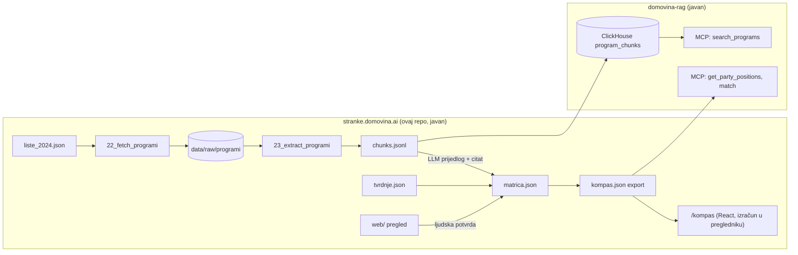

# Plan — Kompas stranaka

## Zašto

Građanin treba moći pronaći stranku čiji program najviše odgovara njegovim stavovima, i to
tako da je rezultat **deterministički, provjerljiv i potkrijepljen citatom iz programa**.
Vektorska baza programa služi za razgovor i dokaze (RAG kroz MCP), a preporuka se računa
otvorenom formulom nad ručno potvrđenom matricom stavova, kao Wahl-O-Mat, StemWijzer ili
Smartvote. AI je sučelje i pomoćnik pri pripremi; o rezultatu ne odlučuje.

## Arhitektura

## Tvrdi uvjeti (svaka sesija)

1. **Determinizam:** rezultat podudaranja ovisi samo o odgovorima, težinama i `matrica.json`.
   Nikakav LLM poziv ne sudjeluje u izračunu. Ista formula postoji u TS i Pythonu i golden
   testovi moraju dati identične brojeve.
2. **Svaka ćelija matrice ima doslovni citat** iz programa (dokument + stranica) ili je `null`.
   LLM samo predlaže. U objavljenu matricu ulazi samo ćelija sa statusom `potvrđeno`.
3. **GDPR čl. 9:** odgovori korisnika se ne šalju na server niti spremaju. MCP `match` ne
   logira argumente.
4. **Javni repo:** u git idu metapodaci, kratki citati i matrica. Puni tekstovi programa
   ostaju u `data/raw/` (gitignored).
5. **Ništa se ne objavljuje** (deploy, MCP deploy, mail strankama) bez vrata.
6. Domovina-rag pravila vrijede tamo: nova CH tablica dobiva korak u `scripts/sync-cron.sh`;
   MCP deploy ide kroz `services/mcp/deploy.sh`.

## Sesije

| # | Faza | Paket | Odluke | Gotovo kad |
| --- | --- | --- | --- | --- |
| S1 | F0 | `check.sh`, liste 2024, fetch programa, mjerenje pokrivenosti | 100 | `./scripts/check.sh` zelen; `programi.json` pokriva sve liste s mandatom (nađen ili izričito „nema”); izvještaj o pokrivenosti napisan |
| — | vrata 1 | korisnik potvrđuje opseg | | odluka upisana na vrh `S2.md` |
| S2 | F0 | ekstrakcija teksta i chunking | 200 | `chunks.jsonl` za sve programe u opsegu; pytest provjerava stranice i dijakritike; izmjeren udio stranica koje traže OCR |
| S3 | F0 | domovina-rag: `program_chunks`, ETL, `search_programs`, eval | 300 | vitest zelen u domovina-rag; recall@5 izmjeren na 20 pitanja i zapisan; sync-cron korak dodan; bez deploya |
| S4 | F1 | metodologija, 40 tvrdnji, shema matrice + validator | 400 | `metodologija.md` i `tvrdnje.json` postoje; validator u `check.sh` |
| — | vrata 2 | korisnik odobrava tvrdnje | | odobrenje upisano na vrh `S5.md` |
| S5 | F1 | alat za pregled u `web/`, provjera citata | 500 | pytest pokriva prihvati/ispravi/odbij i odbijanje nepostojećeg citata |
| — | vrata 3 | trošak LLM prijedloga | | korisnik odobrio procjenu |
| S6 | F1 | LLM prijedlozi ocjena, dva prolaza, slaganje | 600 | sve ćelije imaju prijedlog ili `null`; 100 % citata prolazi doslovnu provjeru; slaganje dvaju prolaza izmjereno |
| — | ljudski pregled | korisnik/urednici potvrđuju ćelije | | `matrica.json` bez ćelija u statusu `predloženo` |
| S7 | F2 | formula podudaranja TS + Python, golden testovi | 700 | vitest i pytest daju iste rezultate na ≥ 50 golden slučajeva |
| S8 | F2 | ruta `/kompas`, export, bez slanja odgovora | 800 | build zelen; e2e (playwright) prolazi kroz upitnik; mrežni log ne sadrži odgovore |
| S9 | F2 | draftovi mailova strankama, pravna bilješka | 900 | draft po stranci u Gmailu (linkovi očišćeni); bilješka u `docs/research/` |
| — | vrata 4 | slanje, odgovori stranaka, odobrenje objave | | odluka na vrhu `S10.md` |
| S10 | F2 | deploy `/kompas` + MCP `get_party_positions`, `match` | 1000 | stranica živa i provjerena u pravom pregledniku; MCP `/health` nova verzija; alati odgovaraju |
| S11 | F3 | glasanja Sabora: izvor, fetch, mapiranje na tvrdnje | 1100 | raw cache + mapiranje s poveznicama; izmjerena pokrivenost tvrdnji glasanjima |
| — | vrata 5 | korisnik odobrava mapiranje glasanja | | |
| S12 | F3 | „program vs glasanje” u `/kompas` i MCP-u | 1200 | testovi zeleni, deploy uz vrata |

**Procjena:** 12 sesija i 5 vrata. Ljudski pregled matrice je najdulji korak i ne radi ga sesija.

**Paralelno:** S3 (domovina-rag) i S4 (metodologija) ne dijele datoteke i mogu ići paralelno
nakon S2. S7 može ići paralelno sa S5/S6 jer radi na sintetičkoj matrici.

**Najrizičnije:**
- **S1, pokrivenost:** ako veći dio lista nema javni program, opseg se mijenja (vrata 1).
- **S4, izbor tvrdnji:** tu ulazi pristranost; zato vrata 2 i javna metodologija prije rezultata.
- **S6, kvaliteta prijedloga:** ako je slaganje dvaju prolaza nisko, ljudski pregled raste.
- **S9, pravno:** izborna šutnja i GDPR mogu promijeniti oblik objave.

## Gdje smo

S0 (2026-11-19): plan napisan, koda nema. Sljedeća je S1.
